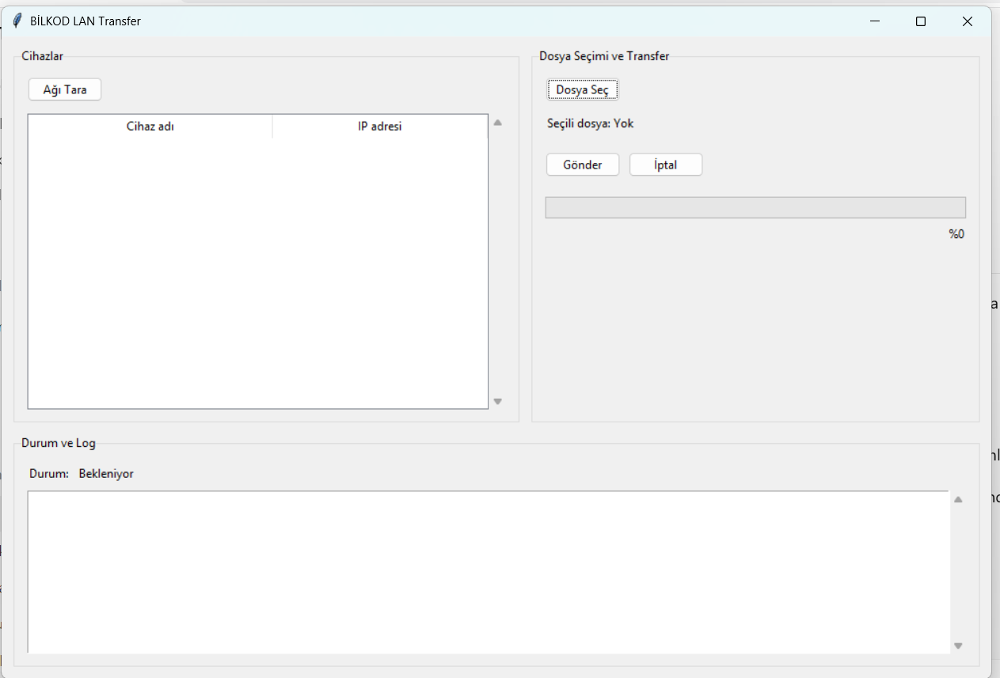

# Issue #4 Evidence | W1-K3 Tkinter UI İskeleti

## 1. Başarılı Akış / Görsel Doğrulama

**Çalıştırma komutu:** `python -m ui.main_window`

### Gözlemim

Uygulama sorunsuz açıldı. Cihaz listesi, dosya seçim ve transfer paneli ile durum/log alanı düzgün görüntülendi. İlerleme çubuğu %0, başlangıç durumu Bekleniyor olarak gösterildi.

## 2. Etkileşim ve Hata Kontrolleri

- [x] Dört butonu test ettim, herhangi bir hata oluşmadı.
- [x] Pencereyi küçültüp büyüttüm, yerleşim bozulmadı.
- [x] Pencereyi kapattım, terminalde hata oluşmadı.

## 3. Ekip Üyesi Açıklaması

### Ne Yaptım? (Özet)

Tkinter ile üç panelli bir arayüz oluşturdum. Cihaz listesi, dosya seçim ve transfer butonları, ilerleme çubuğu ve durum/log alanlarını ekledim. Butonlar ileride işlev kazandırılmak üzere hazırlandı.

### Değiştirilen Dosyalar

- `ui/main_window.py`
- `docs/evidence/week-1/issue-3/evidence.md`
- `docs/evidence/week-1/issue-3/screenshot.png`

### Nasıl Test Ettim?

Uygulamayı terminalden çalıştırarak tüm bileşenleri kontrol ettim. Butonlar, pencere boyutlandırma ve kapatma işlemleri sorunsuz çalıştı. Ayrıca 19 statik kontrol başarıyla tamamlandı.

### Kısıt ve Mimari Kontrol Beyanı

- [x] Yalnızca izin verilen UI ve evidence alanlarında değişiklik yapıldı.
- [x] Gerçek ağ veya dosya aktarım işlemi eklenmedi.
- [x] `print()` kullanılmadığı ve callback'lerin boş olduğu doğrulandı.