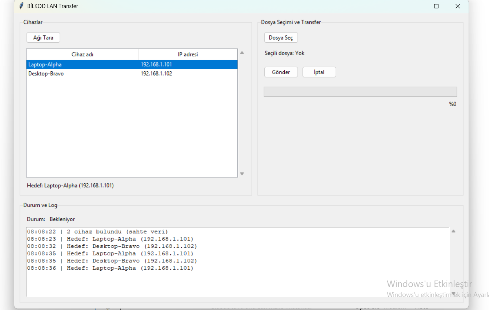
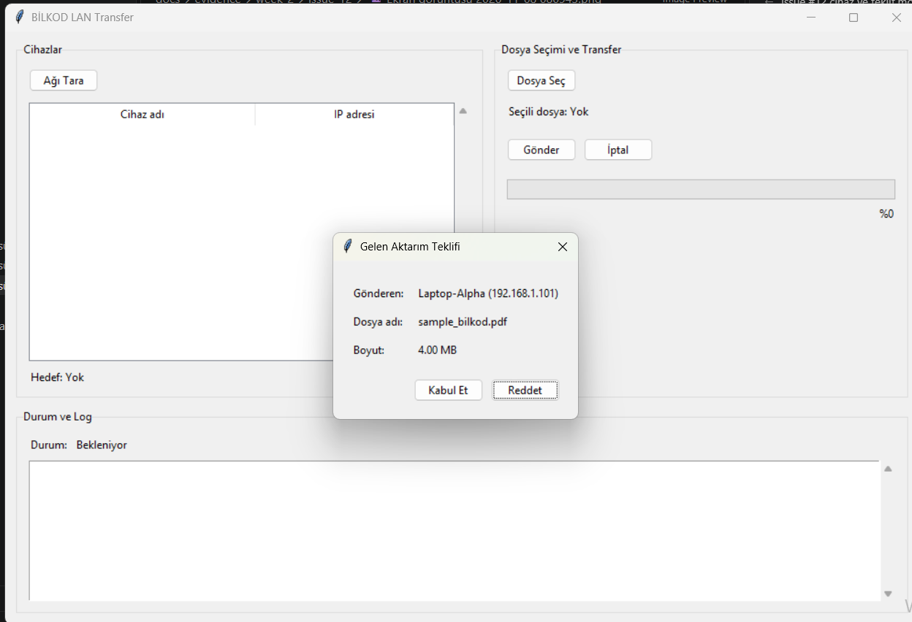
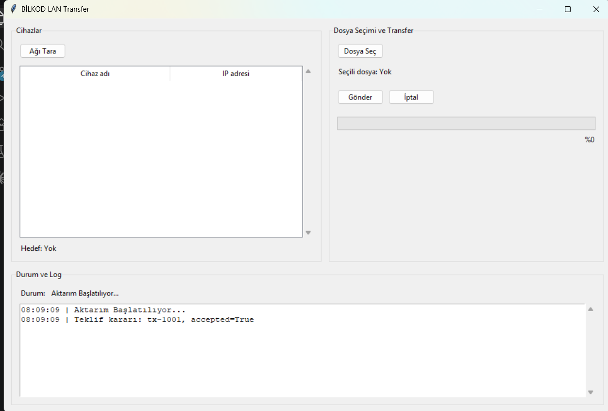
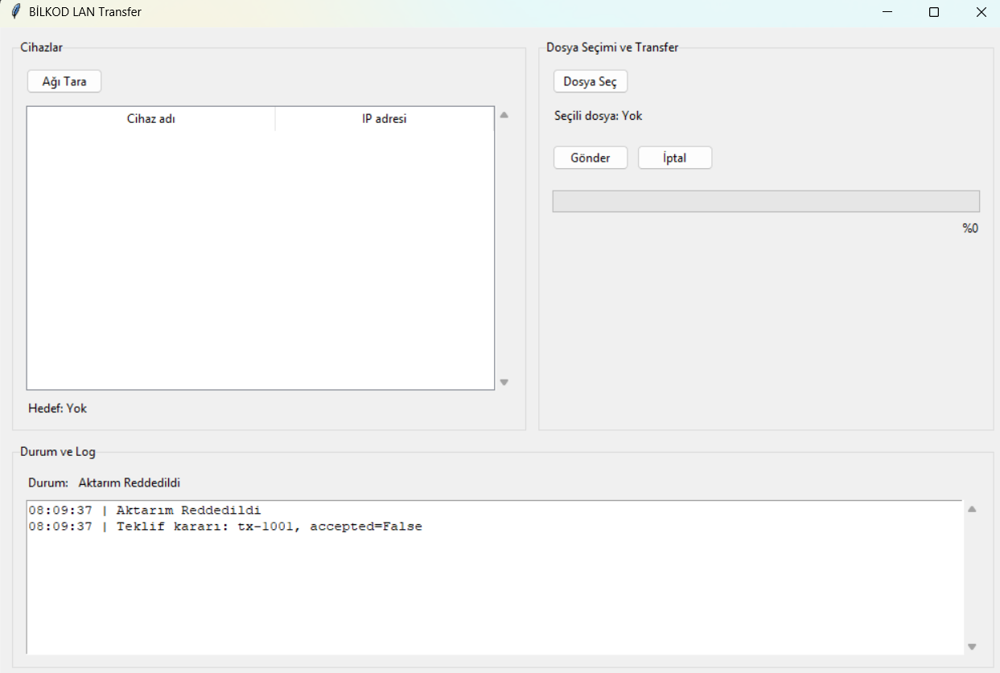

# Issue #12 — [W2-K3] Cihaz seçimi ve aktarım kabul/ret diyaloğu

- Dal: `k3/week-2-ui-approval-flow`
- Taban ve PR hedefi: `week/2`
- Ortam: Windows, Python 3.13.15, Tkinter
- Veri: `fixtures.fake_devices.get_mock_devices()` ve `fixtures.fake_transfers.MOCK_OFFER`

Sürüm kontrolü:

```powershell
python --version
```

```text
Python 3.13.15
```

## Çalıştırma komutları

Repo kökünde normal açılış:

```powershell
python -m ui.main_window
```

Gelen teklif demosu (yaklaşık 500 ms sonra modal açılır):

```powershell
python -m ui.main_window --demo-offer
```

Cihaz listesi için **Ağı Tara** kullanılabilir. Kabul ve ret durumlarını ayrı ayrı görmek için demo yeniden başlatılabilir. Açılış odağı **Reddet** butonundadır. Enter odaktaki butonu çalıştırır; Escape ve pencerenin X düğmesi ret sonucunu verir.

## Otomatik testler

```powershell
$env:PYTHONIOENCODING='utf-8'
python -B -m unittest discover -s docs/evidence/week-2/issue-12 -p test_ui_approval.py -v
```

Gerçek çalıştırmanın sonuç özeti (uygulamanın INFO log satırları çıkarılmıştır):

```text
test_binary_unit_boundaries_and_fractional_sizes ... ok
test_accept_updates_status_and_notifies_decision ... ok
test_append_log_timestamps_appends_and_disables_widget ... ok
test_clearing_selection_clears_target ... ok
test_decision_stub_only_logs ... ok
test_load_devices_filters_self_and_replaces_old_rows ... ok
test_reject_updates_status_and_notifies_decision ... ok
test_reload_clears_stale_selection ... ok
test_repeated_scans_do_not_repeat_no_target_log ... ok
test_scan_logs_number_of_visible_remote_devices ... ok
test_selection_event_updates_target_and_log ... ok
test_unchanged_selection_does_not_repeat_target_log ... ok
test_accept_button_returns_true ... ok
test_dialog_displays_sender_filename_size_and_modal_settings ... ok
test_enter_accepts_and_escape_rejects ... ok
test_initial_focus_is_reject_button ... ok
test_reject_button_returns_false ... ok
test_unknown_sender_uses_sender_id ... ok
test_window_close_is_rejection ... ok

----------------------------------------------------------------------
Ran 19 tests in 1.789s

OK
```

`format_size` 1024 tabanını kullanır; B tam sayı, KB/MB/GB iki ondalıkla gösterilir. Test edilen örnekler: `0 B`, `1023 B`, `1.00 KB`, `1.50 KB`, `4.00 MB`, `1.00 GB`.

## Kapsam kontrolü

```powershell
git diff --stat week/2
git diff --check
git diff --name-only week/2 -- network/ discovery/ transfer/ storage/ core/ contracts/ fixtures/ app.py
```

Değişiklikler yalnızca `ui/` ve `docs/evidence/week-2/issue-12/` altındadır. Yasaklanan dizinler ve `app.py` değişmedi. Yeni paket, socket import'u, gerçek dosya işlemi veya `print()` eklenmedi. Üç panelin mevcut yerleşimi korundu.

## Ekran görüntüleri

### Cihaz seçili hali


### Modal açık


### Kabul sonrası


### Ret sonrası

